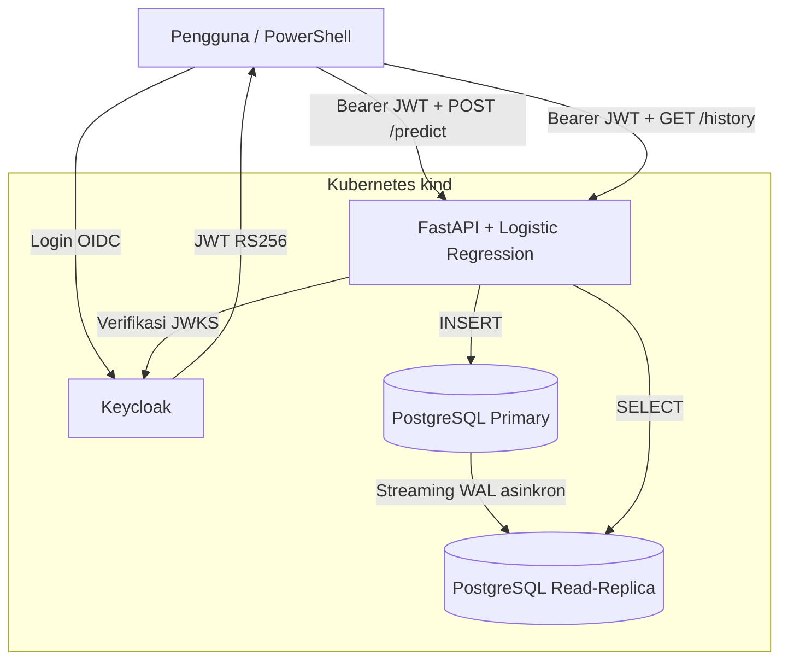

# Proyek UTS SBDT — PostgreSQL Terdistribusi, Keycloak SSO, dan FastAPI

**Mata kuliah:** Sistem Basis Data Terdistribusi (SBDT)
**Lingkungan:** Windows PowerShell 5.1, Docker Desktop, Kubernetes kind
**Status:** Implementasi utama **telah berhasil diuji** pada Docker Compose dan cluster Kubernetes lokal `uts-sbdt`. Konfigurasi untuk instalasi ulang telah diperbaiki, tetapi **instalasi bersih dari awal belum diuji ulang**.

> **Proyek pendidikan, bukan produksi.** Model prediksi dilatih menggunakan **data sintetis**. Semua layanan demo memakai HTTP lokal dan Keycloak `start-dev`. Jangan digunakan untuk data finansial atau identitas nyata.

## 1. Arsitektur

- **PostgreSQL Primary:** menerima penulisan hasil inferensi melalui `POST /predict`.
- **PostgreSQL Read-Replica:** menerima *physical streaming replication* asinkron dari Primary dan melayani `GET /history`.
- **Keycloak:** menyediakan autentikasi OIDC dan menerbitkan JWT yang diverifikasi FastAPI menggunakan JWKS, issuer, dan audience `sbdt-api`.
- **FastAPI:** menyajikan model Logistic Regression sintetis, validasi JWT, dan routing database untuk baca/tulis.
- **Docker Compose:** menjalankan empat service `db-primary`, `db-replica`, `keycloak`, dan `api`.
- **Kubernetes kind:** menjalankan StatefulSet PostgreSQL, PVC, Service, ConfigMap, Secret, Deployment, dan Traefik Ingress.



**Batas arsitektur:** ini bukan sistem *multi-primary* dan tidak mempunyai *automatic failover*. Replikasi asinkron dapat menyebabkan jeda singkat sebelum data baru tersedia pada Replica. PVC kind menggunakan penyimpanan node lokal; pengujian pemulihan Pod **tidak** membuktikan toleransi kehilangan seluruh node.

## 2. Struktur proyek

| Berkas/folder | Kegunaan |
|---|---|
| `app/` | Kode FastAPI dan pelatihan model sintetis |
| `postgres/` | Inisialisasi Primary, skema SQL, dan pengaturan standby |
| `keycloak/realm.json` | Realm dan client demonstrasi Keycloak |
| `Dockerfile` | Image FastAPI dengan *multi-stage build* |
| `docker-compose.yml` | Empat service untuk pengujian lokal |
| `k8s/` | Manifest Kubernetes, kind, dan nilai Helm Traefik |
| `scripts/deploy-k8s.ps1` | Pemasangan **awal** Kubernetes pada namespace baru |
| `scripts/test-compose.ps1` dan `scripts/test-k8s.ps1` | Skrip pengujian integrasi |
| `.env.example` | Daftar variabel konfigurasi tanpa nilai rahasia |

**Jangan commit:** `.env`, file backup, ekspor Keycloak, token JWT, kredensial atau manifest Secret berisi nilai asli. `k8s/secret-example-DO-NOT-APPLY.yaml` hanyalah contoh dan **jangan diterapkan**.

## 3. Siapkan konfigurasi lokal

Dari root proyek, menggunakan **Windows PowerShell**:

```powershell
# Hanya jika .env belum ada. Jangan timpa .env milik instalasi aktif.
if (-not (Test-Path .\.env)) { Copy-Item .\.env.example .\.env }
notepad .\.env
```

Isi nilai yang diperlukan dalam `.env`:

```dotenv
POSTGRES_USER=
POSTGRES_DB=
POSTGRES_PASSWORD=
REPL_PASSWORD=
KEYCLOAK_ADMIN=
KEYCLOAK_ADMIN_PASSWORD=
SBDT_DEMO_USER_PASSWORD=
```

Gunakan password **khusus demo**, bukan password pribadi, dan jangan masukkan nilainya ke README. Untuk password demo, skrip deployment mensyaratkan minimal 12 karakter. Nilai password demo digunakan ketika **realm diimpor pertama kali**. Mengubah `.env` atau Secret **tidak otomatis mengubah password akun** di Keycloak yang sudah berjalan.

## 4. Docker Compose — instalasi dan pengujian lokal

> Bagian ini untuk memulai/menguji lingkungan Compose. Pada instalasi yang sudah memiliki data, jangan menjalankan `docker compose down -v` karena akan menghapus volume.

```powershell
docker compose config --quiet
docker compose up -d --build
docker compose ps
Invoke-RestMethod 'http://localhost:8000/health'
```

Layanan yang diharapkan: `db-primary`, `db-replica`, `keycloak`, `api`. Kedua database mempunyai *healthcheck*. Endpoint `/health` menampilkan status `up` dan nama model `synthetic-logreg-v1`.

**Akses:**

- Keycloak pengguna: `http://localhost:8081/realms/sbdt-uts/account/`
- Keycloak Admin Console: `http://localhost:8081/admin/`
- FastAPI Swagger UI: `http://localhost:8000/docs`

Akun demo menggunakan username `mahasiswa` dan password yang ditentukan untuk **impor pertama**, bukan password tetap yang ditulis di dokumen ini. Untuk akun pada instalasi yang sudah berjalan, gunakan password yang aktif di Keycloak.

Periksa peran database melalui PowerShell:

```powershell
docker compose exec db-primary sh -c 'psql -U "$POSTGRES_USER" -d "$POSTGRES_DB" -tAc "SELECT pg_is_in_recovery()"'
docker compose exec db-replica sh -c 'psql -U "$POSTGRES_USER" -d "$POSTGRES_DB" -tAc "SELECT pg_is_in_recovery()"'
```

Hasil logis yang telah diuji: Primary `f` (*false*) dan Replica `t` (*true*). Periksa `pg_stat_replication` untuk status `streaming` dan `async`.

Skrip pengujian yang tersedia:

```powershell
.\scripts\test-compose.ps1
```

Periksa parameter dan kredensial yang diminta skrip sebelum menjalankannya. Bukti pengujian aktual menunjukkan token sah dapat digunakan untuk inferensi, hasil disimpan pada Primary dan dapat dibaca melalui Replica; permintaan tanpa JWT dan JWT palsu ditolak.

## 5. Kubernetes kind — hanya untuk pemasangan baru

**Jangan jalankan tahapan ini pada cluster `uts-sbdt` yang sudah aktif.** Skrip `deploy-k8s.ps1` dirancang untuk pemasangan awal dan menolak namespace yang sudah ada. Jangan menghapus cluster, Pod, PVC, atau volume demi mengikuti tutorial ulang.

Prasyarat: Docker Desktop aktif; tersedia `kubectl`, `kind`, dan `helm`; konfigurasi `.env` sudah lengkap. Image `sbdt-uts-api:v1` harus tersedia dalam node kind.

Pada **lingkungan baru** yang belum memiliki cluster bernama `uts-sbdt`:

```powershell
kind create cluster --name uts-sbdt --config k8s/kind-config.yaml --wait 3m

helm repo add traefik https://traefik.github.io/charts
helm repo update
helm install traefik traefik/traefik -n traefik --create-namespace -f k8s/traefik-values.yaml --wait --timeout 5m

docker compose build api
kind load docker-image sbdt-uts-api:v1 --name uts-sbdt

.\scripts\deploy-k8s.ps1
```

Perintah `helm install` mengasumsikan release Traefik **belum ada**. Jika cluster/release sudah tersedia, periksa statusnya dahulu; jangan menjalankan pemasangan ganda.

Skrip deployment membuat Secret dari `.env`, termasuk `SBDT_DEMO_USER_PASSWORD`, dan ConfigMap dari `keycloak/realm.json`. **Jangan tampilkan `kubectl get secret -o yaml` atau konfigurasi hasil interpolasi ke laporan maupun GitHub.**

### Domain lokal dan Ingress

Tambahkan entri berikut pada file `C:\Windows\System32\drivers\etc\hosts` menggunakan editor yang dijalankan sebagai administrator:

```text
127.0.0.1 auth.lokal
127.0.0.1 api.lokal
```

Konfigurasi kind memetakan port localhost `8088` ke NodePort Traefik `30080`.

- Keycloak: `http://auth.lokal:8088/realms/sbdt-uts/account/`
- FastAPI: `http://api.lokal:8088/health`
- Swagger UI: `http://api.lokal:8088/docs`
- Metadata OIDC: `http://auth.lokal:8088/realms/sbdt-uts/.well-known/openid-configuration`

Pemeriksaan non-destruktif pada cluster yang sudah berjalan:

```powershell
kubectl --context kind-uts-sbdt -n uts-sbdt get statefulsets,pods,pvc,services,ingress
kubectl --context kind-uts-sbdt -n uts-sbdt get deployments
Invoke-RestMethod 'http://api.lokal:8088/health'
```

Skrip uji Kubernetes:

```powershell
.\scripts\test-k8s.ps1
```

Periksa isi/parameter skrip sebelum menjalankannya. Jangan memasukkan token JWT ke screenshot atau GitHub.

## 6. Hasil praktikum yang sudah terbukti

| Pengujian | Hasil yang diamati |
|---|---|
| Docker Compose | Empat layanan berjalan; database sehat |
| Replikasi PostgreSQL | Primary `pg_is_in_recovery() = false`, Replica `true`, WAL `streaming / async` |
| StatefulSet & PVC | Primary dan Replica `1/1 Ready`, PVC masing-masing `Bound` 1 GiB |
| Persistensi Pod | Pod Primary dan Replica dibuat ulang; UID Pod berubah, PVC yang sama dan data uji tetap tersedia |
| Traefik Ingress | Endpoint FastAPI dan metadata OIDC Keycloak berhasil HTTP 200 |
| SSO + JWT | Access token dari Keycloak diterima FastAPI setelah audience `sbdt-api` disesuaikan |
| `POST /predict` | Model mengembalikan ID dan label risiko; `write_node: primary` |
| `GET /history` | Membaca riwayat dengan `read_node: standby`, `standby_confirmed: true` |
| SQL Primary vs Replica | Record inferensi **ID 2**, nominal **8.000.000**, skor **0.8025347681855304**, label **tinggi** terlihat identik pada kedua database Kubernetes |

Bukti didokumentasikan sebagai screenshot **SS-01 sampai SS-12C** dalam laporan; SQL pembanding **SS-12D** telah diverifikasi melalui terminal dan screenshot aslinya perlu dilampirkan untuk dokumentasi final.

## 7. Rubrik proyek Bagian III

| Komponen | Bobot | Bukti |
|---|---:|---|
| Arsitektur dan Docker Setup | 20% | Dockerfile multistage, empat service Compose |
| Kubernetes dan Storage | 25% | StatefulSet, PVC Bound, bukti persistensi Pod |
| SSO | 20% | Login Keycloak, JWT valid dan penolakan token tidak sah |
| Model dan Replikasi | 20% | `/predict` tulis Primary, `/history` baca Replica, SQL verifikasi |
| Laporan dan Git | 15% | Repository sumber, manifest, diagram, screenshot aktual, PDF |

Pembagian tersebut adalah bobot **di dalam Bagian III**, bukan tambahan terhadap nilai UTS keseluruhan.

## 8. Batasan dan keamanan

- Model Logistic Regression dilatih dari **data sintetis** dan bukan penilaian risiko finansial untuk penggunaan nyata.
- Keycloak Kubernetes masih berjalan dengan **`start-dev` dan penyimpanan H2 tanpa PVC khusus**. Perubahan manual di Admin Console dapat hilang saat Pod diganti. File impor realm dan *partial export* **bukan backup penuh database Keycloak**.
- Perbaikan Audience Mapper, password placeholder, serta role akun demo sudah disimpan pada `realm.json` dan ConfigMap. **Deployment lokal `04-apps.yaml` yang diperbarui belum diterapkan ke Keycloak aktif** untuk menghindari risiko kehilangan konfigurasi.
- Impor realm Keycloak tidak otomatis memperbarui realm yang sudah ada. Belum ada bukti instalasi Kubernetes bersih yang diulang setelah seluruh perubahan konfigurasi.
- Password grant untuk pengujian CLI hanya dipakai pada laboratorium; aplikasi produksi sebaiknya memakai Authorization Code + PKCE.
- PostgreSQL memakai replikasi asinkron, tanpa *automatic failover* atau *high availability* lintas node.
- PVC kind berbasis penyimpanan lokal node dan tidak membuktikan ketahanan kehilangan node.
- HTTP dan domain `.lokal` hanya untuk laptop pengujian. Produksi memerlukan TLS, pengelolaan Secret, backup, monitoring, dan kebijakan akses.
- Jangan commit `.env`, file backup, ekspor konfigurasi aktif Keycloak, kredensial asli, atau JWT. Sebelum publikasi, lakukan audit file staged.

## 9. Referensi teknis

- Soal UTS Sistem Basis Data Terdistribusi, Bagian III (dokumen dosen).
- [PostgreSQL: Warm Standby / Streaming Replication](https://www.postgresql.org/docs/current/warm-standby.html)
- [Keycloak: Importing and exporting realms](https://www.keycloak.org/server/importExport)
- [Kubernetes StatefulSets](https://kubernetes.io/docs/concepts/workloads/controllers/statefulset/)
- [Traefik Helm Chart](https://github.com/traefik/traefik-helm-chart)
- [Docker Multi-stage builds](https://docs.docker.com/build/building/multi-stage/)
